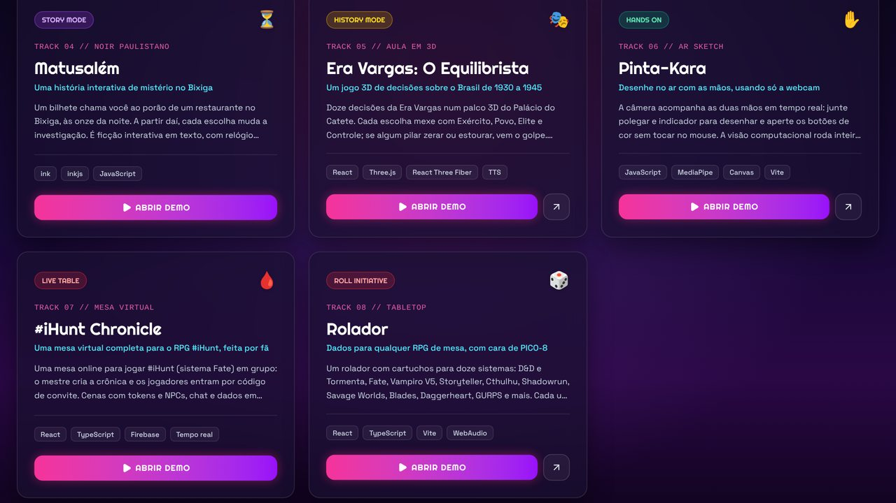

<div align="center">

# 🌴 Portfólio do Peter

**Coisas que eu fiz e que estão no ar:** jogos, histórias interativas e experimentos com IA.
Cada projeto é uma fita no deck: é só escolher e apertar play.

[](https://javaijafoi.vercel.app)


</div>

## 🕹️ O que tem lá

Uma vitrine interativa com estética de anos 80, synthwave e arcade. Cada projeto vira um cartão com chamada, descrição, tecnologias, botão de demo e link para o código.

<div align="center">

</div>

| Fita | Projeto | O que é | Código |
| --- | --- | --- | --- |
| 01 | [**Antigravitus**](https://antigravitus.vercel.app) | Diário de aventuras num RPG de texto, jogado por agentes de IA | [repo](https://github.com/javaijafoi/antigravitus) |
| 02 | [**Picotron Arena**](https://picotron-arena.vercel.app) | Dez modos de arcade caóticos num computador de fantasia | [repo](https://github.com/javaijafoi/picotron-arcade) |
| 03 | [**Jogo do Davi**](https://jogo-davi.vercel.app) | Jogo para crianças aprenderem a ler e a contar | [repo](https://github.com/javaijafoi/Jogo-davi) |
| 04 | [**Matusalém**](https://matusalem-six.vercel.app) | História interativa de mistério no Bixiga | — |
| 05 | [**Era Vargas: O Equilibrista**](https://era-vargas-seliga.vercel.app) | Jogo 3D de decisões sobre o Brasil de 1930 a 1945 | [repo](https://github.com/javaijafoi/era-vargas-seliga) |
| 06 | [**Pinta-Kara**](https://pinta-kara.vercel.app) | Desenhe no ar com as mãos, usando só a webcam | [repo](https://github.com/javaijafoi/pinta-kara) |
| 07 | **#iHunt Chronicle** | Mesa virtual para o RPG #iHunt (em pausa) | — |
| 08 | [**Rolador**](https://rolador-javaijafoi.vercel.app) | Dados para qualquer RPG de mesa, com cara de PICO-8 | [repo](https://github.com/javaijafoi/rolador) |
| 09 | [**Pico Poetry**](https://pico-poetry.vercel.app) | Petiscos de poesia em pixel: sorteie, escolha as cores e compartilhe | [repo](https://github.com/javaijafoi/pico-poetry) |
| 10 | [**Arena de Arton**](https://arena-de-arton.vercel.app) | Simulador de combate tático por turnos de Tormenta 20 (homenagem de fã) | [repo](https://github.com/javaijafoi/arena-de-arton) |

Outros projetos públicos no GitHub: [iFone](https://github.com/javaijafoi/ifone) ([no ar](https://ifone-javaijafoi.vercel.app)), o celular de mentira para mesas de #iHunt, e o [iHunt App](https://github.com/javaijafoi/iHunt-app), um fork do Fari App para jogar Fate online. O perfil do autor é [@javaijafoi](https://github.com/javaijafoi), e cada um desses repositórios aponta de volta para este portfólio.

## 🚀 Rodando localmente

```bash
npm install
npm run dev      # http://localhost:3000
npm run build    # build de produção
npm run lint
```

O conteúdo dos cartões fica em `data/projects.ts`, e os textos da interface em `components/`. Para adicionar um projeto, basta incluir um item novo na lista.

## 🧱 Tecnologias

- **Framework:** Next.js 16 (App Router) e React 19
- **Estilo:** Tailwind CSS v4, glassmorphism e efeitos neon
- **Tipografia:** Google Fonts (`Righteous` e `Space Grotesk`)
- **Áudio:** síntese FM de anos 80 com a Web Audio API
- **Deploy:** Vercel

---

Feito por Peter ([@javaijafoi](https://github.com/javaijafoi)).
